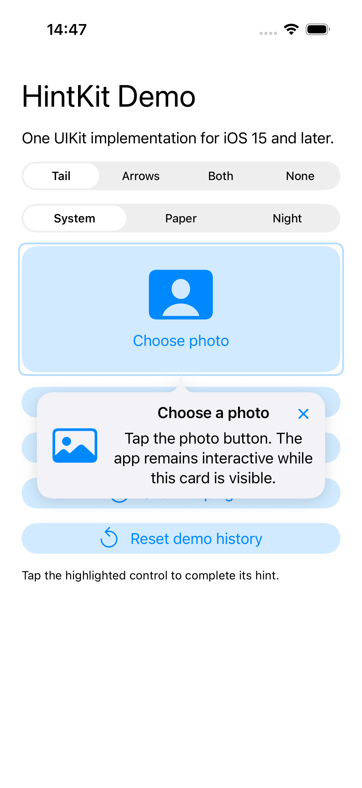
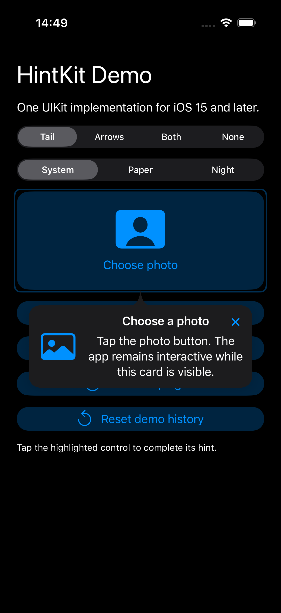
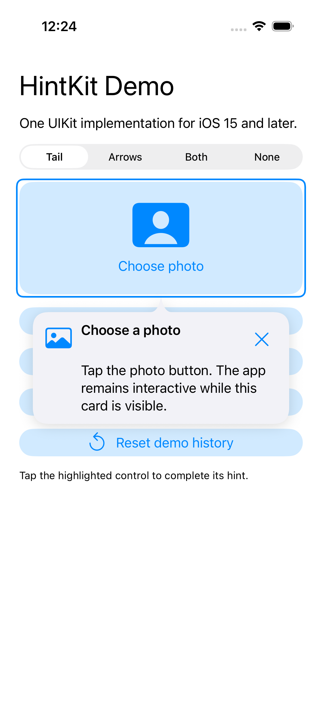
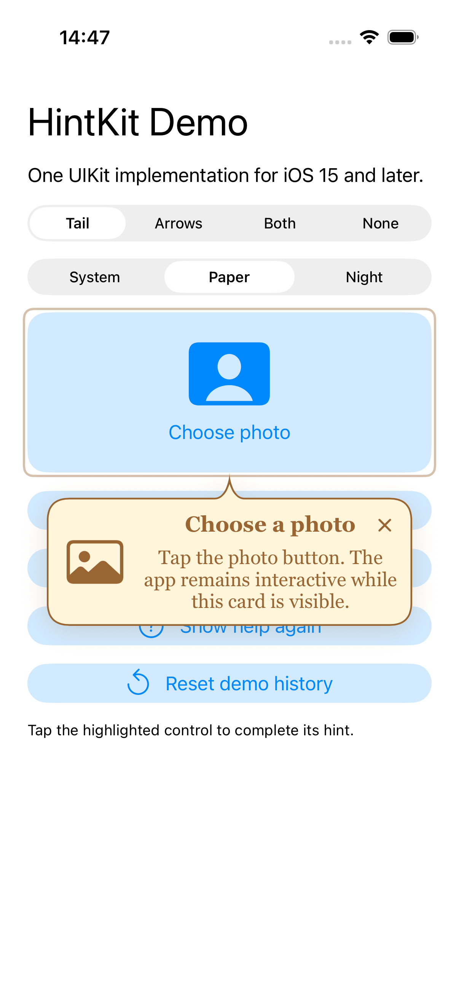
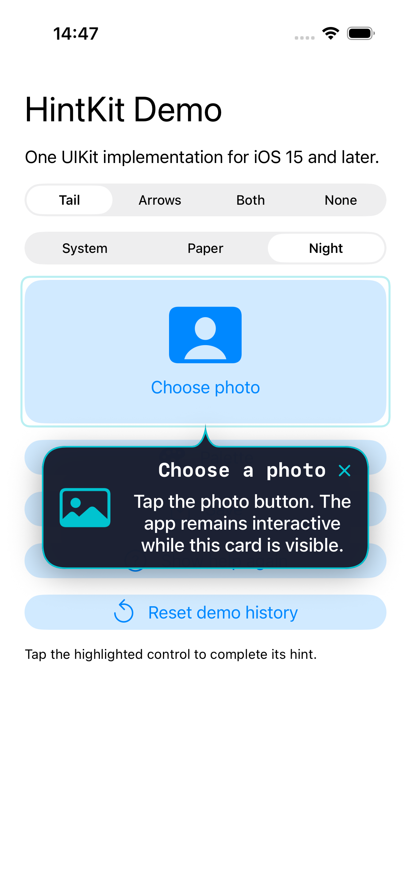

# HintKit

This branch prepares **HintKit 0.2.0**. The current published release is
**0.1.0**; the 0.2.0 additions will be released after review.
See [what is new](#whats-new-in-020-preview) and the
[upgrade instructions](#updating-from-010) before changing an existing dependency.

Contextual, nonmodal UIKit hints for iOS 15 and later. The same implementation
works across supported iOS versions, without an Apple TipKit dependency.

Show a card next to a button or image, highlight the target, and remember which
features the user has learned. HintKit handles presentation; your app supplies
the content and decides when an action has actually succeeded.

<p>
  
  
</p>

- Anchored cards with automatic arrows, optional curved bubble tails, and safe-area placement.
- One visible hint at a time, with an optional queue and completion history.
- Customizable appearance and an optional animated target outline.
- Dynamic Type, VoiceOver, Reduce Motion, and right-to-left text support.
- JSON catalogs, localized content supplied by the app, and screenshot exclusion.
- No third-party dependencies. Distributed under the [MIT license](LICENSE).

HintKit includes a Swift package, an Xcode framework target, automated tests,
and a standalone demo. Both distribution forms use the same Swift files and
storyboard. The package manifest uses Swift tools version 5.9.

| Requirement | Version |
| --- | --- |
| App deployment target | iOS 15 or later |
| Swift package tools | Swift 5.9 or later, with an iOS SDK |
| Included Xcode projects | Xcode 16 or later |

For a step-by-step integration walkthrough, see the [integration guide](Documentation/Guide.md).

## What's new in 0.2.0 (preview)

| Feature | How to use it |
| --- | --- |
| Curved bubble tails | Set `HintOptions(pointerStyle: .tail)`; `.tailAndArrows` combines both decorations. |
| An exact target point | Pass `sourcePoint` to `show` or `enqueue`, in the target view's coordinates. |
| Four-sided placement | Choose `.above`, `.below`, `.left`, or `.right`; placement falls back when needed to fit the safe area. |
| Custom typography | Set `HintStyle.titleFont` and `messageFont`; Dynamic Type scaling remains enabled by default. |
| Card borders and shadows | Supply `HintBorder` and `HintShadow.custom`; the border follows the card and tail together. |
| Appearance from the target | Opt in to `.fromAnchor`, keep the default `.fade`, or choose `.none`, with a configurable duration. |

Background, text, tint colors, and corner radius are configurable too. See
[bubble tails and targeting](#bubble-tails-and-exact-targets-020-development)
and [appearance examples](#appearance-and-export) for code and screenshots.
The demo includes System, Paper, and Night themes.

The library still supports iOS 15 and later without Apple TipKit. Existing
`show`, `enqueue`, JSON catalogs, history policies, and export calls remain
available. Colors, fonts, borders, and appearance motion keep their released
defaults; the new options are enabled explicitly.

## Install with Swift Package Manager

In Xcode, choose **File → Add Package Dependencies**, enter
`https://github.com/Hayyim-K/HintKit.git`, and select version **0.1.0** or later.
Add the **HintKit** library product to your app target.

For a package manifest:

```swift
dependencies: [
    .package(url: "https://github.com/Hayyim-K/HintKit.git", from: "0.1.0")
]
```

Add `.product(name: "HintKit", package: "HintKit")` to your target's dependencies.
The package includes its storyboard and localized resources automatically.

## Updating from 0.1.0

### Choose a release or the preview

**For a released dependency:** 0.1.0 is currently the published release.
The new APIs are in `october-improvements` and [Draft PR #1](https://github.com/Hayyim-K/HintKit/pull/1).
Updating a version-based dependency today will not install these changes.
Even after the PR is merged, a 0.2.0 release tag is needed for version-based
installation.

**To try the preview now:** in Xcode's project settings, select HintKit under
Package Dependencies and set its dependency rule to Branch:
`october-improvements`. Alternatively, use this requirement in `Package.swift`:

```swift
.package(url: "https://github.com/Hayyim-K/HintKit.git", branch: "october-improvements")
```

The preview branch can change during review. You can also clone that branch
and add its root as a local package, as described in
[Add to an app](#add-to-an-app). Replace the existing dependency rather than
adding a second copy of HintKit. Let Xcode resolve the dependency and rebuild
the consuming app before using the new APIs.

**After 0.2.0 is published:** select the new version in Xcode's dependency rule
and update the package. An Exact Version rule pinned to 0.1.0 must be changed;
it will not advance automatically. With a version range, ensure the range
allows 0.2.0, then update to the latest permitted version. In a package
manifest, the released requirement can be:

```swift
.package(url: "https://github.com/Hayyim-K/HintKit.git", from: "0.2.0")
```

Use that version requirement only after the release tag exists. If you tried
the preview, switch its Branch rule back to a version rule for release use.
Review and commit the resulting `Package.resolved` change if your app tracks
that file; do not edit it by hand.

For a local package or embedded Xcode framework, update its checkout to the
chosen revision and rebuild the app and framework together. Do not install
both the framework and Swift package into the same app target.

### Keep existing behavior or enable the new features

No source migration is required for existing calls: new initializer arguments
have defaults. Symbol arrows remain the default pointer. Fonts remain system
headline/body unless supplied, and borders remain off unless supplied.
Existing plain cards remain unshadowed with `shadow: .automatic`.

The default remains the 0.1.0 fade-only appearance over 0.15 seconds. No motion
configuration is required when updating. To opt in to expansion from the
target, pass these options to `show` or `enqueue`:

```swift
let options = HintOptions(
    appearanceAnimation: .fromAnchor,
    animationDuration: 0.22
)
hints.show(photoHint, near: photoButton, in: self, options: options)
```

If you already configure `HintOptions`, add those two arguments to your
existing options to preserve its policy and other settings. `animates: false`
still disables appearance and outline animation; Reduce Motion is respected.

Opt in to the decorations you want, such as `pointerStyle: .tail`. Configure fonts, borders, and shadows
in the presenter's `HintStyle`. A style belongs to its presenter; create a
new presenter with the same store when switching themes.

Keep the same hint IDs, `HintStore` namespace, and UserDefaults suite to retain
learning history. Updating the library does not require clearing history or
changing JSON catalogs. Call `markCompleted` after a successful feature action
and keep wrapping image capture in `withHintsHidden` as before.

### Verify the integration

Run your normal hint flow, replay help, and confirm that the highlighted
control can still be tapped. Check long localized text, large Dynamic Type,
light/dark appearance, and Reduce Motion. If you export images, confirm that
cards, tails, outlines, borders, and shadows are absent from the export.

For troubleshooting, first check the resolved dependency: code using
`HintBorder`, `HintShadow`, `sourcePoint`, or `appearanceAnimation` will not
compile against 0.1.0. A missing automatic hint can also be an existing history
policy; use `.always` to replay it without deleting the user's history.

## Try the demo

Open `Examples/HintKitDemo/HintKitDemo.xcodeproj`, select the shared
`HintKitDemo` scheme, and run on an iPhone or iPad simulator. It imports HintKit
as a local Swift package. Tap Photo, Palette, and Save to complete the sequence.
Show help again replays hints without resetting history. Reset demo history
affects only the demo's HintKit namespace.

Use the Tail / Arrows / Both / None selector to compare pointer styles.
The demo starts with Tail; the library default remains Arrows.
Use System / Paper / Night to compare fonts, backgrounds, borders, and shadows.

The demo simulates these actions; it does not choose or save real photos.

## Add to an app

For local development, add this repository's root directory as a local Swift
package dependency and link its `HintKit` product. Alternatively, add
`HintKit.xcodeproj`, depend on its framework target, and embed the resulting
framework in the app. Use one distribution form per app target.

For CI, the source must be checked out with the app or made available as a
package dependency. A path outside the checked-out repository is not available
on Xcode Cloud. Keep the `Main.storyboard` and `Resources` directory with the
package; HintKit loads them from its own bundle, not `Bundle.main`.

## Show a hint

Keep a presenter as a property of the host view controller. Call `show` after
the host has appeared and its target view is laid out. All UI APIs run on the
main actor.

```swift
import UIKit
import HintKit

final class PhotoViewController: UIViewController {
    @IBOutlet private weak var photoButton: UIButton!
    private let hints = HintPresenter()

    override func viewDidAppear(_ animated: Bool) {
        super.viewDidAppear(animated)
        hints.show(
            Hint(id: "photo.choose", title: "Choose a photo",
                 message: "Tap here to choose a photo.", imageName: "photo"),
            near: photoButton, in: self
        )
    }

    @IBAction private func photoChosen(_ sender: UIButton) {
        hints.markCompleted("photo.choose")
    }

    override func viewWillDisappear(_ animated: Bool) {
        hints.cancelAll()
        super.viewWillDisappear(animated)
    }
}
```

`show` returns `false` if another card is active, its display policy excludes it,
the host has another presented controller, the target is hidden/offscreen, or
there is not enough room to fit a readable card. Failed attempts do not consume
history. The target must belong to the host's view hierarchy and window.

Cards are child view controllers inside the host, not modal presentations.
Empty overlay areas pass touches through to the existing interface. The card
is placed within the safe area, above or below the anchor by default. Descriptions scroll
when necessary. A display link tracks movement and scrolling of the target;
the card closes if its anchor disappears. Keyboard appearance, app inactivity,
and host disappearance cancel active and pending hints.

For a large view, `sourceRect` can specify a smaller anchor region in that
view's coordinates. `HintOptions.placement` expresses a preference; the other
side is used if it is the only side with enough space.

## Bubble tails and exact targets (0.2.0 development)



Opt in to a curved tail that joins the card background and points to its target:

```swift
hints.show(
    Hint(id: "photo.choose", title: "Choose a photo", message: "Tap here."),
    near: photoButton,
    in: self,
    sourcePoint: CGPoint(x: photoButton.bounds.midX, y: photoButton.bounds.minY),
    options: HintOptions(placement: .above, pointerStyle: .tail)
)
```

`sourcePoint` is optional. It is expressed in the target view's own coordinates
and must be inside `sourceRect` (or `target.bounds` when no rectangle is given).
Without a point, the tail aims at the nearest edge of the visible anchor region.
`sourceRect` still controls the region used for placement and highlighting, so a
precise tip does not require a zero-sized rectangle or a separate invisible view.

| `HintOptions.pointerStyle` | Presentation |
| --- | --- |
| `.arrows` | Existing SF Symbol arrows; the default for existing callers. |
| `.tail` | A curved tail attached to the card background. |
| `.tailAndArrows` | Both the tail and the existing arrows. |
| `.none` | No pointer decoration. |

`highlightsTarget` independently controls the target outline in all four modes.
Existing `Hint.arrows` tags and JSON files keep their original meaning.

Cards can prefer `.above`, `.below`, `.left`, or `.right`. In automatic tail mode,
HintKit first tries above/below, then the horizontal sides if there is too little
vertical room. Existing automatic arrow mode continues to use above/below.
Left/right are physical directions and are not mirrored by RTL text layout.

Use `HintStyle(tailLength: 14, tailWidth: 26)` to change the tail's dimensions in
points. `tailLength` reserves additional space between card and anchor, on top
of `anchorSpacing`. An explicit point deeper inside the target can make the
actual tail longer. The base stays clear of rounded corners; the tip keeps its
exact target position even when the card has to shift near a screen edge.

The tail and card use one background path, including with translucent colors.
They remain nonmodal: the tail never intercepts touches or becomes a separate
VoiceOver element. Movement, scrolling, appearance changes, dismissal, and
`withHintsHidden` cover the entire bubble. A clipped/offscreen exact point
causes the hint to close rather than leave a detached pointer.

These additions are in the current checkout and are not part of the published
0.1.0 tag. Use the local package to try them before the next release.

## Queue and history

```swift
hints.enqueue(photoHint, near: photoButton, in: self)
hints.enqueue(paletteHint, near: paletteButton, in: self)
```

Eligible hints appear one at a time. Dismissal advances the queue, without
background threads or semaphores. Hosts and anchors are held weakly.
Callbacks run once for hints that were actually shown, not skipped requests.
Use `cancelAll` before presenting a photo picker, alert, or another screen.

The default policy is `untilDismissed`:

| Policy | Display condition |
| --- | --- |
| `always` | Ignore history; useful for a help button. |
| `once` | No previous successful presentation. |
| `untilDismissed` | Neither explicitly dismissed nor completed. |
| `untilCompleted` | Feature use has not been recorded; closing the card is insufficient. |

Call `markCompleted` when the relevant action actually succeeds. Programmatic
cancellation does not mark the feature completed or explicitly dismissed.

```swift
let store = HintStore(namespace: "photo-editor")
let hints = HintPresenter(store: store)
let replay = HintOptions(displayPolicy: .always)
hints.show(photoHint, near: photoButton, in: self, options: replay)
```

`HintStore` persists counts, dismissal, and completion in UserDefaults.
Namespaces isolate independent flows. `reset(id)` affects one hint;
`resetAll()` affects only the current namespace, never unrelated app settings.
Tests can inject a separate UserDefaults suite.

## JSON and localization

`HintCatalog` accepts the original Space Wildfires JSON array format:

```json
[
  {
    "id": "photo.choose",
    "title": "Choose a photo",
    "message": "Tap here to choose a photo.",
    "imageName": "photo",
    "arrows": []
  }
]
```

```swift
let catalog = try HintCatalog(contentsOf: jsonURL)
if let hint = catalog["photo.choose"] {
    hints.show(hint, near: photoButton, in: self)
}
```

Empty and duplicate identifiers throw `HintCatalogError`. Invalid JSON throws
the underlying decoding error. `title`, `imageName`, and `arrows` can be omitted.
Leave `arrows` empty for automatic direction. Legacy tags 0–2 represent upper
left/center/right arrows and 3–5 represent lower arrows.

Localize title and message in the consuming app before constructing a Hint.
There is no dependency on a particular app's localization mechanism.
For a translated VoiceOver close label, pass `HintStyle(closeAccessibilityLabel:)`.
Text supports Dynamic Type and natural writing direction; directional arrows
remain tied to physical anchor coordinates in right-to-left interfaces.

## Appearance and export

Pass a `HintStyle` when creating the presenter. It applies to that presenter's
cards, including every pointer mode:

```swift
let style = HintStyle(
    maximumWidth: 300,
    cornerRadius: 24,
    backgroundColor: .secondarySystemBackground,
    foregroundColor: .label,
    tintColor: .systemOrange,
    titleFont: .systemFont(ofSize: 19, weight: .bold),
    messageFont: .systemFont(ofSize: 17),
    border: HintBorder(color: .systemOrange, width: 1.5),
    shadow: .custom(color: .black, opacity: 0.2, radius: 10,
                    offset: CGSize(width: 0, height: 4))
)
let hints = HintPresenter(style: style)
```

Custom fonts use unscaled base sizes at the standard Large text category.
HintKit scales them with `UIFontMetrics`; pass
`scalesFontsForContentSizeCategory: false` to keep their sizes fixed. `nil`
fonts retain the system headline/body styles. Dynamic colors follow the host's
light/dark appearance, including the border and shadow.

Borders follow the whole silhouette, including a tail, and draw inside it.
Omit `border` for no outline. `shadow: .none` removes the shadow; the default
`.automatic` keeps plain arrow cards unshadowed and gives tail cards a subtle
shadow. Shadows do not clip the text or intercept touches.

<p>
  
  
</p>

### Appearance animation (0.2.0 development)

Cards retain fade-only appearance over 0.15 seconds by default. Opt in to a
gentle expansion from the target with `.fromAnchor`, as shown below.
An explicit `sourcePoint` is also the animation's origin. The background,
tail, border, shadow, and content move together; the target outline stays fixed.
Configure motion per presentation:

```swift
let options = HintOptions(
    pointerStyle: .tail,
    appearanceAnimation: .fromAnchor,
    animationDuration: 0.22
)
hints.show(photoHint, near: photoButton, in: self, options: options)
```

Keep `.fade` for the default fade-only effect or choose `.none` for immediate
appearance. `animates: false` disables both appearance motion and outline
pulsing; a zero duration disables appearance motion only. Reduce Motion
disables all these animations. Existing calls compile unchanged; expansion
from the anchor is enabled explicitly.

The highlight animates a separate layer, without modifying the target's
transform. Visible hints can be
announced to VoiceOver; disable this per presentation with
`announcesForVoiceOver: false` when the app provides its own announcement.

Hide cards and highlight layers during synchronous image capture:

```swift
let image = hints.withHintsHidden {
    renderPostcard()
}
```

Visibility is restored even if the operation throws. Nested capture blocks
are supported. The consuming app remains responsible for using this API
around its screenshot/export code.

## Tests

The shared HintKit Xcode scheme runs the tests under `Tests/HintKitTests`:

```sh
xcodebuild -project HintKit.xcodeproj -scheme HintKit \
  -destination 'platform=iOS Simulator,name=iPhone SE (3rd generation),OS=17.5' \
  -parallel-testing-enabled NO CODE_SIGNING_ALLOWED=NO test
```

Select a simulator installed on your Mac. The same tests are declared by the
Swift package and can be run from its package workspace in Xcode. They cover
JSON compatibility, persistence, eligibility, queueing, resource loading,
touch passthrough, close callbacks, moving anchors, long text, keyboard
cancellation, and export visibility.

The Xcode test targets use iOS 17 or later to match the XCTest runtime in the
current SDK. The HintKit library and demo app still support iOS 15.

The demo UI tests tap the highlighted controls, close a card, replay help,
and switch pointer modes and themes through the real app interface:

```sh
xcodebuild -project Examples/HintKitDemo/HintKitDemo.xcodeproj \
  -scheme HintKitDemo \
  -destination 'platform=iOS Simulator,name=iPhone 17,OS=26.2,arch=arm64' \
  -parallel-testing-enabled NO CODE_SIGNING_ALLOWED=NO test
```

Adjust the destination and architecture for your Mac and installed simulators.

The initial release was verified with all 19 tests in both distribution forms
on iOS 17.5, the demo UI test on iOS 26.2, and an unsigned Release build for an
iPhone destination. Direct runtime verification on iOS 15 is still pending.
The 0.2.0 development branch adds coverage for tails, styling, and animation:
39 framework tests on iOS 17.5 and 3 demo UI tests on iOS 26.2 passed. The demo
build verifies the local Swift package and its resources.

## Contributing

Bug reports and pull requests are welcome. Include the iOS and Xcode versions,
the anchor's layout, and a small reproduction when reporting a placement issue.
See [CONTRIBUTING.md](CONTRIBUTING.md) for the development workflow.

## License

HintKit is available under the [MIT license](LICENSE).
Copyright © 2024–2026 Vitalii Kukhar (Hayyim).
